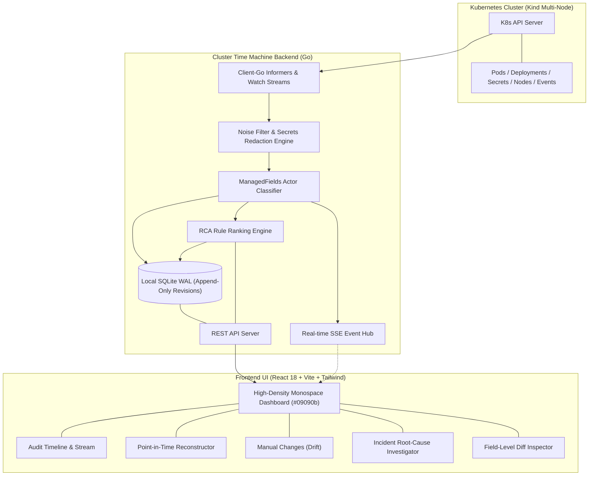

# Cluster Time Machine (CTM)

**Cluster Time Machine** is a lightweight, local-first audit recorder, point-in-time reconstructor, and incident root-cause analyzer for Kubernetes clusters.

Engineered specifically for DevOps and SRE teams needing immediate, high-fidelity answers to:
> *"What changed in the cluster, when did it change, and who or what changed it?"*

Featuring high tabular density, high-contrast monospace typography, zero bloat, and fast local-first SQLite time-travel mechanics.

---

## Key Capabilities

1. **Continuous Resource Audit Stream**:
   - Streams live changes across Deployments, StatefulSets, DaemonSets, ReplicaSets, Pods, ConfigMaps, Secrets, Services, Ingresses, HPAs, Nodes, PVCs, and Warning/Error Events.
   - Client-go informer watchers with SHA-256 content deduplication and noise stripping.

2. **$O(1)$ Time Travel Reconstruction**:
   - Reconstruct any single resource or full namespace at historical timestamp $T$.
   - Rebuilds active resource topology on or before $T$, omitting deleted resources.
   - Export point-in-time multi-resource manifests with a single click.

3. **Field-Level Diff Inspector (YAML)**:
   - Structured visual diffs between any two revisions (Side-by-Side, Unified Diff, or Field Table).
   - Line-by-line attribution of added, removed, or modified values.

4. **Automated Incident Detection**:
   - Real-time detection of critical cluster failure states:
     - `OOMKilled` (exitCode: 137 / container lastState)
     - `CrashLoopBackOff`
     - `ImagePullBackOff` / `ErrImagePull`
     - `FailedScheduling` / `Unschedulable`
     - `NodeNotReady` (Cordoned or network down)
     - Critical Kubernetes Warning/Error Events

5. **Rule-Ranked Root Cause Analysis (RCA)**:
   - Investigates changes in preceding $N$ minutes (configurable lookback: 5m, 15m, 30m, 60m).
   - Heuristically scores and ranks candidate root causes based on:
     - **Actor Attribution**: Human manual CLI change (`+50`) vs GitOps (`+25`) vs Controller (`+5`).
     - **Resource Proximity**: Direct target (`+40`) vs Parent Deployment/Workload (`+35`) vs Shared ConfigMap/Secret (`+20`) vs Node (`+40`).
     - **Causal Field Matching**: Memory limit adjustments before OOM (`+60`), Image tag changes before ImagePullBackOff (`+60`), Env/Command changes before CrashLoop (`+50`), Node cordoning/requests before FailedScheduling (`+60`).
     - **Temporal Proximity**: Decay scoring prioritizing changes within $\le 2$ minutes of incident trigger.

6. **Actor Classification (`metadata.managedFields`)**:
   - Extracts manager attribution into:
     - **Human**: `kubectl-edit`, `kubectl-patch`, `kubectl-set`, `k9s`, `lens`, `dashboard`.
     - **GitOps**: `argocd-application-controller`, `helm`, `flux`, `kustomize-controller`.
     - **Controller/System**: `kubelet`, `kube-controller-manager`, `kube-scheduler`.

7. **Dedicated Manual Changes View**:
   - Pinpoints out-of-band drift where engineers performed direct modifications bypassing GitOps pipelines.

8. **Zero-Knowledge Secrets Security**:
   - Sensitive values in `Secret` payloads are NEVER stored in plaintext. Key names are preserved and data payloads are SHA256 hashed.
   - High-entropy tokens and sensitive environment variables (`DATABASE_PASSWORD`, `API_KEY`, etc.) in Pods and Deployments are automatically redacted.

---

## Architecture & Tech Stack



- **Backend**: Go 1.24+ with `client-go`, `modernc.org/sqlite` (pure Go, CGO-free, WAL mode).
- **Frontend**: React 18, Vite 5, Tailwind CSS, Lucide Icons.
- **Database**: SQLite with append-only schema:
  - `resources (id, uid, namespace, kind, name, created_at)`
  - `resource_revisions (id, resource_id, resource_version, timestamp, actor_type, manager_name, change_type, raw_json)`
  - `incidents (id, title, severity, namespace, resource_kind, resource_name, detected_at, description, ranked_changes_json)`
  - Index: `idx_revisions_lookup ON resource_revisions(resource_id, timestamp)`

---

## Quickstart Guide

### 1. Prerequisites
- Go 1.22+
- Node.js 18+ & npm
- Docker & `kind` (optional for live cluster testing; standalone demo mode requires neither!)

### 2. Setup Multi-Node Kind Cluster (Optional)
```bash
./scripts/setup-kind.sh
./scripts/seed-cluster.sh
```

### 3. Build & Run
```bash
# Build frontend and backend, then start server
./scripts/run.sh

# Or run directly:
./ctm -port 8080 -db cluster_timemachine.db
```

Access the UI at: **[http://localhost:8080](http://localhost:8080)**

---

## Chaos Simulation & Live Demo

CTM includes built-in scenarios that can be triggered either from the **Chaos Lab** modal in the UI or via scripts:

```bash
# Simulate Human memory limit squeeze -> OOMKilled
./scripts/simulate-chaos.sh oom

# Simulate container image typo -> ImagePullBackOff
./scripts/simulate-chaos.sh image

# Simulate worker node cordon -> FailedScheduling
./scripts/simulate-chaos.sh cordon

# Restore cluster to healthy baseline
./scripts/simulate-chaos.sh restore
```
